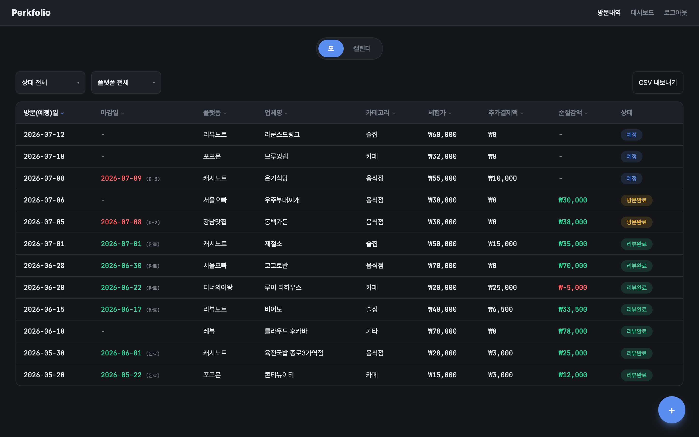
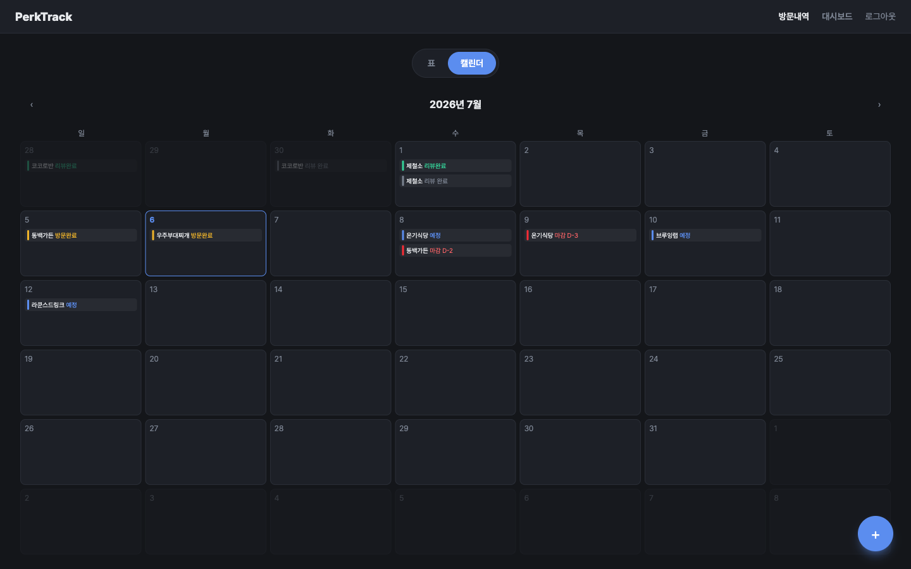
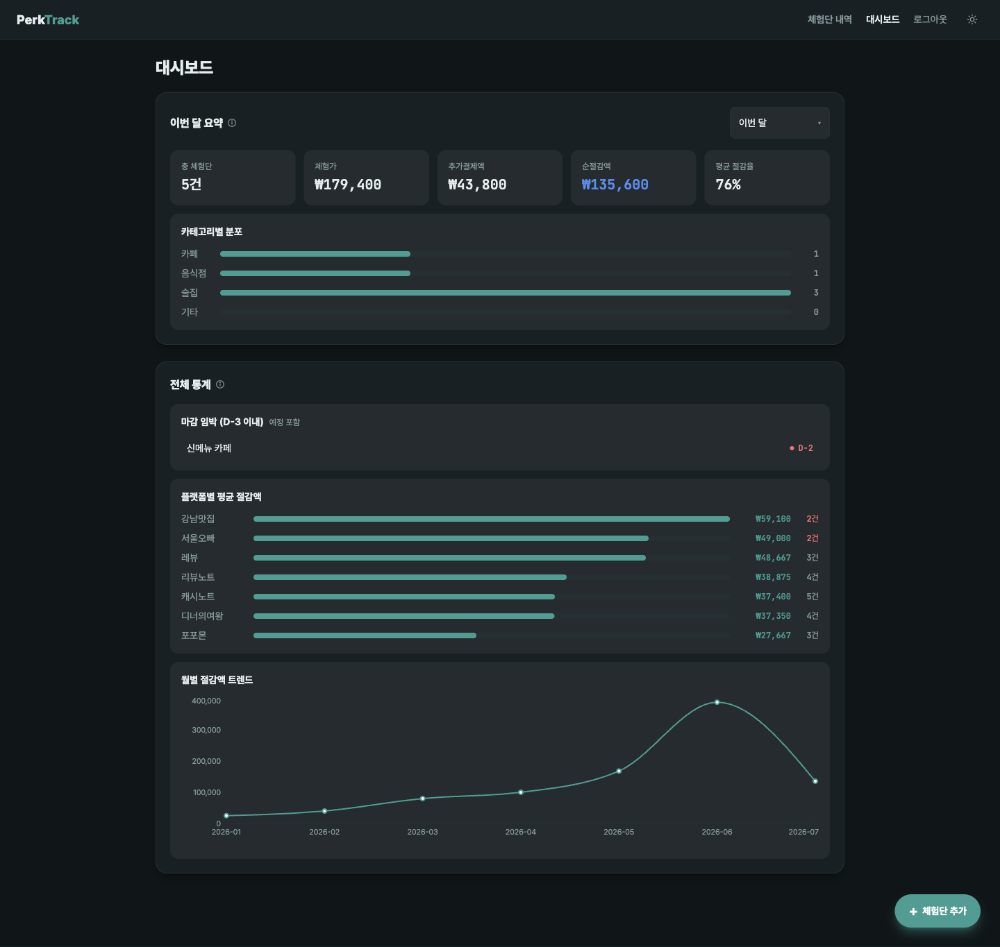

# Perkfolio

개인 블로거를 위한 체험단 방문 관리 웹앱입니다. 여러 체험단 매칭 플랫폼(포포몬, 캐시노트, 레뷰 등)을 통해 받는 체험 방문 기록을 한곳에 모으고, 절감액과 리뷰 마감일을 관리할 수 있습니다.

**배포:** [perkfolio.vercel.app](https://perkfolio.vercel.app)

## 스크린샷

| 표 뷰 | 캘린더 뷰 |
|---|---|
|  |  |



> 스크린샷은 예시 데이터입니다.

## 주요 기능

- **방문 기록 관리** — 방문일, 마감일, 플랫폼, 업체명, 카테고리, 리뷰 유형(블로그/클립/유튜브/인스타 게시물/릴스 중복 선택), 체험가/추가결제액, 예약 메모, 포스팅 링크(복수) 등을 기록 (`/add`, `/edit/:id`)
- **표 · 캘린더 뷰** — 방문 내역을 정렬/필터 가능한 표 또는 월간 캘린더로 확인 (`/table`, `/calendar`), 무한 스크롤로 목록을 나눠 불러오고 모바일에서는 카드 목록으로 자동 전환
- **대시보드** — 기간별 요약(총 방문/체험가/순절감액/평균 절감율), 카테고리 분포, 플랫폼별 평균 절감액, 월별 트렌드, 마감 임박 알림 (`/dashboard`)
- **인증** — 이메일/비밀번호 회원가입·로그인, 네이버 소셜 로그인, 비밀번호 찾기/재설정. 방문 기록은 계정별로 분리되어 보임 (Supabase RLS)
- **마이페이지** — 블로그 링크 연동/해제, 문의 등록 및 관리자 답변 확인, 계정 삭제 (`/mypage`)
- **문의 · 피드백** — 사용자가 등록한 문의를 관리자가 확인하고 답변하는 전용 페이지 (`/admin/feedback`)
- **다크/라이트 테마 토글** — 선택한 테마는 기기별로 저장되어 다음 방문 시에도 유지

## 기술 스택

| 영역 | 사용 기술 |
|---|---|
| Frontend | React 19, TypeScript, Vite |
| 스타일 | Tailwind CSS |
| 라우팅 | React Router |
| 차트 | Recharts |
| 날짜 선택 | react-datepicker |
| 백엔드 / 인증 | Supabase (Postgres + Auth, Row Level Security, Edge Functions) |
| 테스트 | Vitest, React Testing Library |
| 상태 관리 | React state / Context (별도 상태관리 라이브러리 없음) |

## 시작하기

### 1. 의존성 설치

```bash
npm install
```

### 2. 환경 변수 설정

프로젝트 루트에 `.env.local` 파일을 만들고 Supabase 프로젝트 정보를 채워주세요.

```bash
VITE_SUPABASE_URL=your-supabase-project-url
VITE_SUPABASE_ANON_KEY=your-supabase-anon-key
VITE_NAVER_CLIENT_ID=your-naver-client-id # 네이버 소셜 로그인 사용 시에만 필요
```

### 3. DB 스키마 적용

`supabase/migrations/`의 SQL을 Supabase 프로젝트에 순서대로 적용해주세요 (`visits`/`profiles`/`feedback` 테이블 생성 + RLS 정책 포함). Supabase 대시보드의 SQL Editor에 직접 붙여넣거나, Supabase CLI로 프로젝트를 링크한 뒤 실행할 수 있습니다.

```bash
supabase link --project-ref your-project-ref
supabase db push
```

`supabase/functions/`에는 두 개의 Edge Function이 있습니다. `delete-account`는 계정 삭제 기능에 필요하므로 배포해주세요. `naver-auth`는 네이버 소셜 로그인 사용 시에만 필요하며, 배포 시 `NAVER_CLIENT_ID`/`NAVER_CLIENT_SECRET`을 Supabase 프로젝트 시크릿으로 등록해야 합니다.

```bash
supabase functions deploy delete-account
supabase functions deploy naver-auth
supabase secrets set NAVER_CLIENT_ID=... NAVER_CLIENT_SECRET=...
```

### 4. 개발 서버 실행

```bash
npm run dev
```

기본적으로 http://localhost:5173 에서 실행됩니다.

## 스크립트

| 명령어 | 설명 |
|---|---|
| `npm run dev` | 개발 서버 실행 |
| `npm run build` | 타입 체크 후 프로덕션 빌드 |
| `npm run preview` | 빌드 결과 로컬 미리보기 |
| `npm run lint` | oxlint 검사 |
| `npm test` | Vitest watch 모드 |
| `npm run test:run` | Vitest 1회 실행 (CI/pre-commit용) |

## 폴더 구조

```
src/
├── lib/         # 데이터 접근 및 외부 연동 (Supabase 호출, 포맷팅 등)
├── pages/       # 라우트 단위 화면 (Landing, Login, Signup, ForgotPassword, ResetPassword,
│                #   NaverCallback, Add, Edit, Table, Calendar, Dashboard, MyPage, AdminFeedback)
├── components/  # 재사용 UI 컴포넌트
├── hooks/       # 화면 간 공유되는 커스텀 훅
├── context/     # 전역 컨텍스트 (AuthContext 등)
├── types/       # 공용 타입 정의
└── test/        # 테스트 픽스처(factories) 및 셋업

supabase/
├── migrations/  # DB 스키마 변경 이력
└── functions/   # Edge Functions (naver-auth, delete-account)
```

## 데이터 모델

방문 기록은 Supabase `visits` 테이블에, 사용자 프로필(블로그 연동 정보)은 `profiles`, 문의 내역은 `feedback` 테이블에 저장됩니다. 모든 테이블은 Row Level Security로 사용자별로 자신의 기록만 조회/수정/삭제할 수 있도록 제한되어 있고(관리자 계정만 `feedback` 전체 조회 가능), 계정 삭제 시 관련 데이터가 cascade로 함께 삭제됩니다. 스키마 변경 이력은 `supabase/migrations/`에서 확인할 수 있습니다.

## 테스트

Vitest + React Testing Library로 화면과 공용 로직을 테스트합니다. Husky pre-commit 훅이 커밋 전 `npm run test:run`을 자동 실행합니다.

```bash
npm run test:run
```
